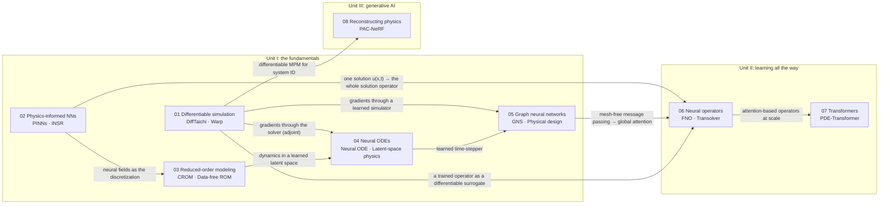

# AI + Physics: a knowledge graph of CPSC 532Z

Notes and code for [CPSC 532Z: Physics-Informed AI](https://chensiyuan030105.github.io/CPSC532Z-Physics-Informed-AI/)
(UBC, Fall 2026). Every paper on the [course schedule](https://chensiyuan030105.github.io/CPSC532Z-Physics-Informed-AI/schedule.html)
lives in exactly one topic folder. Each folder has its own README with the papers, the key ideas, how the topic
connects to the others, and any code written for it.

## The graph

Click a node to open its folder. The edges are the conceptual links between topics, labelled with the idea that
carries over.



If the nodes are not clickable in your viewer (GitHub sometimes disables Mermaid links), use the table below.

## Topics and papers

| Week | Topic folder | Papers | Code in this repo |
| --- | --- | --- | --- |
| 2 | [01 Differentiable simulation](01-differentiable-simulation/) | [Hu+ 2019] DiffTaichi · [Macklin 2024] Warp | [`adjoint/`](01-differentiable-simulation/adjoint/): the adjoint method by hand on a thrown ball |
| 3 | [02 Physics-informed neural networks](02-physics-informed-neural-networks/) | [Raissi+ 2019] PINNs · [Chen+ 2023] INSR | |
| 4 | [03 Reduced-order modeling](03-reduced-order-modeling/) | [Chen+ 2023] CROM · [Sharp+ 2023] Data-free reduced-order kinematics | [`data-free-reduced-kinematics/`](03-reduced-order-modeling/data-free-reduced-kinematics/): Klann linkage and cloth-ball subspaces |
| 5 | [04 Neural ODEs](04-neural-odes/) | [Chen+ 2018] Neural ODE · [Wiewel+ 2019] Latent-space physics | |
| 6 | [05 Graph neural networks](05-graph-neural-networks/) | [Sanchez-Gonzalez+ 2020] GNS · [Allen+ 2022] Physical design with learned simulators | [`gnn/`](05-graph-neural-networks/gnn/): GNS on three colliding balls |
| 7 | [06 Neural operators](06-neural-operators/) | [Li+ 2020] FNO · [Wu+ 2024] Transolver | [`fno/`](06-neural-operators/fno/): FNO on Burgers' equation, every tensor visualised |
| 8 | [07 Transformers](07-transformers/) | [Holzschuh+ 2025] PDE-Transformer | |
| 11 | [08 Reconstructing physics](08-reconstructing-physics/) | [Li+ 2023] PAC-NeRF | |

Week 1 is the course introduction, Weeks 9, 10 and 12 have no paper listed yet ("TBD" or project milestones), and
Week 13 is final presentations. The optional textbook is Brunton & Kutz, *Data-Driven Science and Engineering:
Machine Learning, Dynamical Systems, and Control*.

## The thread through the course: what is being learned?

A useful way to read the graph is to ask, for each paper, *what function the network represents*:

- **A simulator you can differentiate** (01): nothing is learned yet; the solver itself becomes a function you can
  take gradients of.
- **One solution** (02): a PINN or INSR network *is* `u(x, t)` for a single PDE instance. Change the boundary
  condition and you retrain.
- **A low-dimensional manifold of solutions** (03): a decoder maps a few latent coordinates to a full field or
  configuration.
- **The time derivative or the time step** (04, 05): the network is `f` in `dz/dt = f(z)`, or the update
  `x_{t+1} = x_t + Δt · GNN(x_t)`.
- **The solution operator** (06, 07): the network maps an input *function* (coefficients, initial condition,
  geometry) to an output *function*, for any instance and, ideally, any discretization. This is "learning the
  function" in the operator-learning sense.
- **The physics behind observations** (08): the unknowns are material parameters, recovered by fitting a
  differentiable simulator to video.

## Layout

```
.
├── 01-differentiable-simulation/
│   └── adjoint/                       code
├── 02-physics-informed-neural-networks/
├── 03-reduced-order-modeling/
│   └── data-free-reduced-kinematics/  code
├── 04-neural-odes/
├── 05-graph-neural-networks/
│   └── gnn/                           code
├── 06-neural-operators/
│   └── fno/                           code
├── 07-transformers/
└── 08-reconstructing-physics/
```

Code folders follow the same conventions: pure JAX (or NumPy) with no NN framework, a `src/` package, a
`requirements.txt`, and notebooks or experiment scripts. New code for a paper goes inside that paper's topic
folder.
